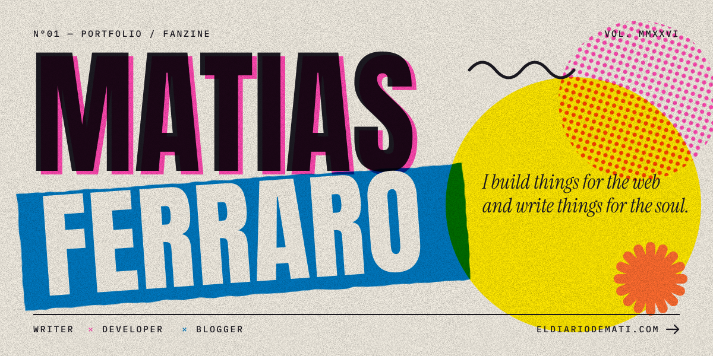
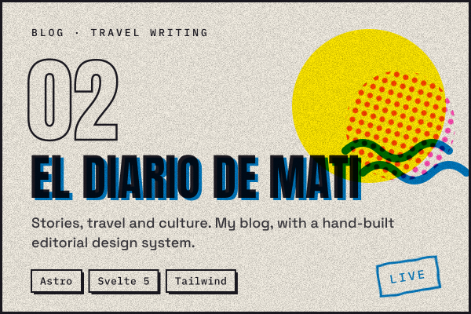
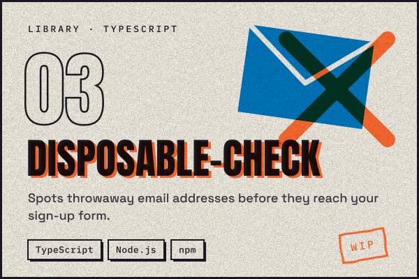
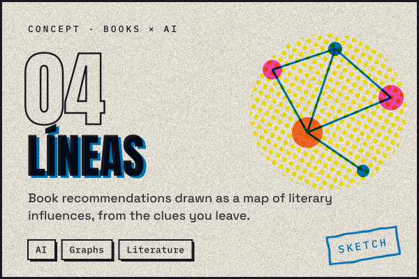
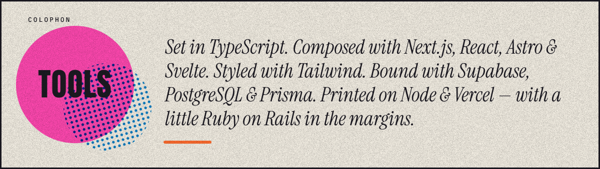
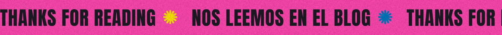

 

> [!NOTE]
> **Hola — I'm Matias.** I write code and I write prose, and I've stopped pretending they're different jobs. Both are about choosing the right word, cutting what doesn't serve the reader, and leaving things a little clearer than I found them.
>
> Full-stack developer, mostly in **TypeScript**. Writer and blogger at **[El Diario de Mati](https://www.eldiariodemati.com/)**, where I collect stories about travel, culture and everything in between.

 

## ✺ Selected work

  <a href="#"><!-- TODO: link a Prosa Limpia --></a>
  
  <a href="#"><!-- TODO: link al repo de disposable-check --></a>
  <a href="#"><!-- TODO: link a Líneas (o borra esta tarjeta) --></a>

 

## ✺ Fresh off the press

<!-- BLOG-POST-LIST:START -->
<!-- BLOG-POST-LIST:END -->

More stories → <a href="https://www.eldiariodemati.com/"><b>eldiariodemati.com</b></a>

 

 

## ✺ Find me

**[eldiariodemati.com](https://www.eldiariodemati.com/)** &nbsp;/&nbsp; **[LinkedIn](https://www.linkedin.com/in/matiasgf/)** &nbsp;/&nbsp; **[GitHub](https://github.com/matataferra?tab=repositories)**

 

